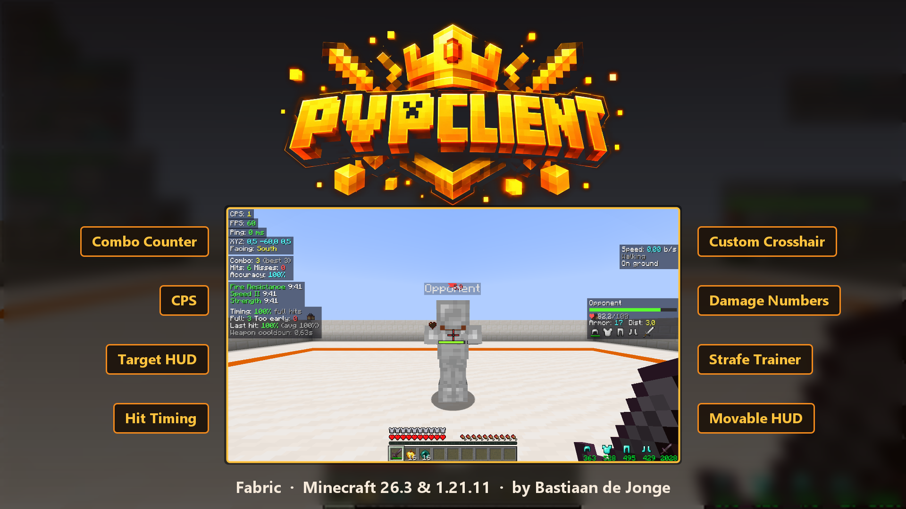
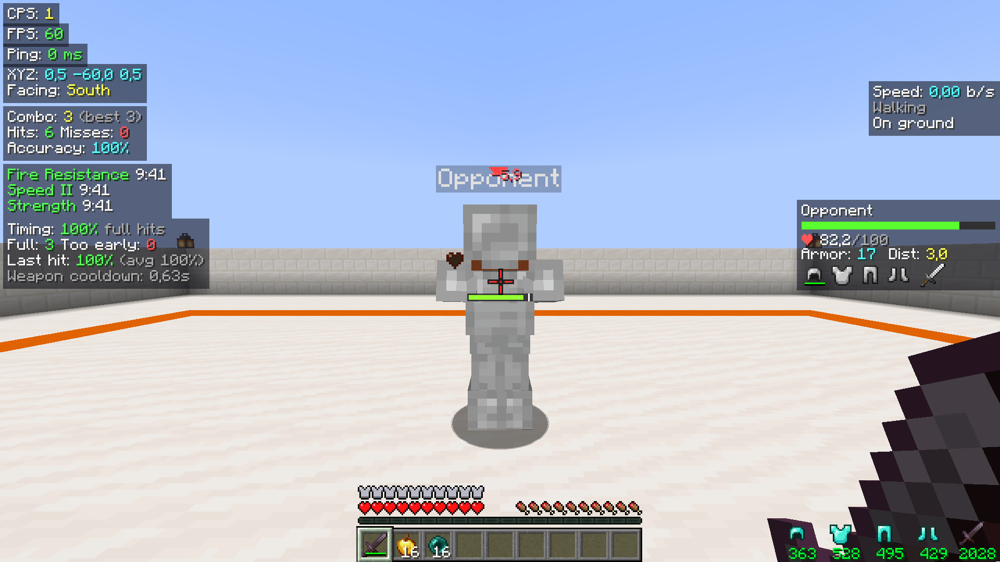
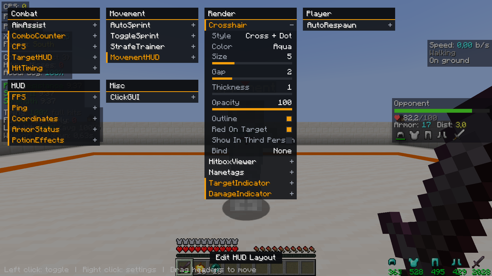
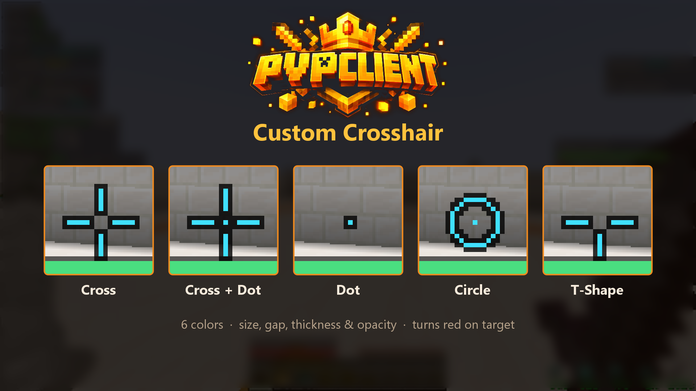
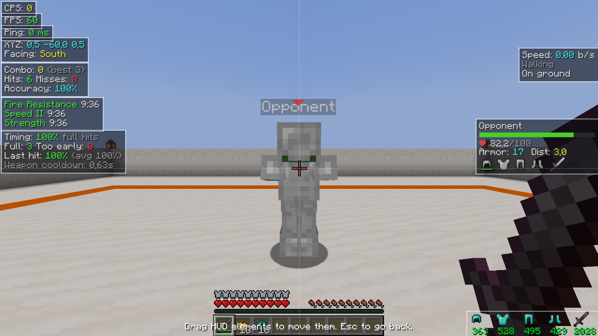

<div align="center">



# PvPClient

**A free, open-source, modular PvP utility client for Minecraft Fabric.**

Combat HUDs, hit-timing training, a custom crosshair and a movable HUD — all controlled from one ClickGUI.

</div>

---

## Supported versions

| Minecraft | Java | Fabric API | Download |
|-----------|------|------------|----------|
| 26.3      | 25   | required   | `pvpclient-1.0.0.jar` |
| 1.21.11   | 21   | required   | `pvpclient-1.0.0+1.21.11.jar` |

Requires **Fabric Loader 0.19.5+** and the **Fabric API**. Mod Menu is optional. The client is client-side only, so it does not need to be installed on servers.

## Install

1. Install [Fabric Loader](https://fabricmc.net/use/) for your Minecraft version.
2. Download the matching jar from the [Releases](../../releases) page.
3. Put it in your `mods` folder together with [Fabric API](https://modrinth.com/mod/fabric-api). On Windows that folder is `%APPDATA%\.minecraft\mods`.
4. Launch Minecraft with the Fabric profile and press **Right Shift**.

## Controls

- **Right Shift** — open the ClickGUI (rebindable).
- **Left click** a module — toggle it on/off.
- **Right click** a module — open its settings.
- **Edit HUD Layout** — drag HUD panels anywhere; they snap to screen edges and centre.
- Every module can be given its own keybind from the ClickGUI.

Settings are saved automatically to `config/pvpclient/client.json`.

## Modules

### Combat
- **ComboCounter** — current combo, best combo, total hits, misses and accuracy.
- **CPS** — clicks per second.
- **TargetHUD** — name, health (with absorption), armor and distance of the entity you are fighting.
- **HitTiming** — a charge bar under the crosshair, an optional tick sound when your next hit does full damage, and a score of how many of your hits were fully charged.
- **BestOptimized Screen** — smooth aim assistance (FOV, smoothness, max distance, target filtering).

### Render
- **Crosshair** — 5 styles, 6 colours, adjustable size/gap/thickness/opacity; can turn red on a target.
- **DamageIndicator** — floating damage numbers.
- **TargetIndicator** — a marker above your current target.
- **Nametags** — health and distance above players you can see.
- **HitboxViewer** — shows entity hitboxes (like F3+B).

### Movement
- **StrafeTrainer** — measures your strafing in fights and tells you when to switch direction.
- **MovementHUD** — speed in blocks per second, sprint and ground state.
- **ToggleSprint** / **AutoSprint**.

### HUD
- **FPS**, **Ping**, **Coordinates**, **ArmorStatus** (durability) and **PotionEffects** (time left).

### Player
- **AutoRespawn** — respawns automatically after an adjustable delay.

## Screenshots

| Combat HUD | ClickGUI |
|---|---|
|  |  |

| Crosshair styles | HUD editor |
|---|---|
|  |  |

## Build from source

Requires JDK 25 (for 26.3) or JDK 21 (for 1.21.11).

```bash
# Minecraft 26.3 (repository root)
./gradlew build

# Minecraft 1.21.11
cd 1.21.11 && ./gradlew build
```

The jars are written to `build/libs/`. To launch a development client:

```bash
./gradlew runClient
```

There is also an automated in-game test:

```bash
./gradlew runClientGameTest
```

## Project layout

```
.
├── src/                 Minecraft 26.3 source
│   ├── main/java/com/example/pvpclient/
│   │   ├── event/       event bus
│   │   ├── module/      module base, manager, settings
│   │   ├── config/      JSON config
│   │   ├── input/       keybinds
│   │   ├── gui/         ClickGUI + HUD editor
│   │   ├── util/        shared trackers and render helpers
│   │   ├── modules/     one file per feature
│   │   ├── targeting/   target selection
│   │   └── rotation/    camera rotation
│   └── gametest/        automated in-game test
└── 1.21.11/             the same client, ported to Minecraft 1.21.11
```

No mixins are used — everything runs through Fabric API events.

## Fair play

Some modules (aim assistance in particular) are not allowed on most multiplayer servers and can get you banned. Use them in singleplayer or on servers that allow them. Always check the rules of the server you play on.

## License

[MIT](LICENSE) © BdejongeDev. Free to use, modify and distribute.

---

*Not an official Minecraft product. Not approved by or associated with Mojang or Microsoft.*
